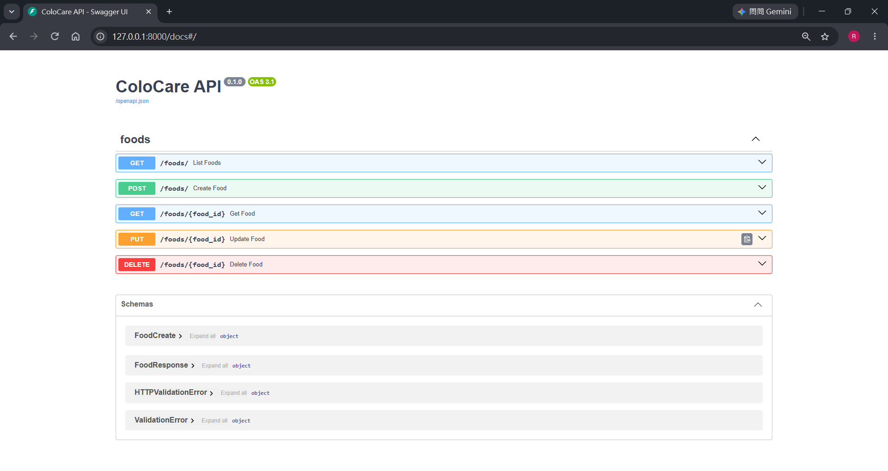
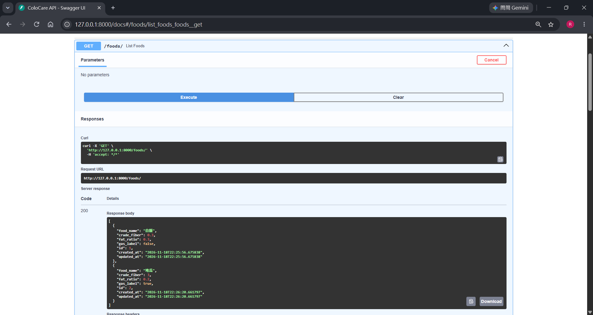
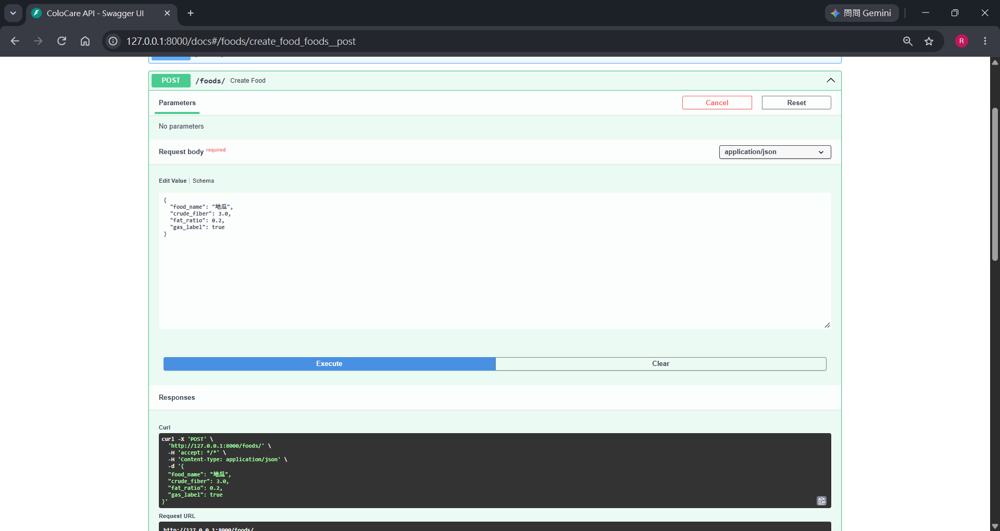

# ColoCare FastAPI

大腸癌飲食管理系統的後端 API，使用 FastAPI + PostgreSQL 重新實作（原版為 Laravel + MySQL）。

## 技術

- Python、FastAPI
- PostgreSQL
- SQLAlchemy（ORM）、Pydantic（資料驗證）

## 功能

- 食物資料（food）的新增、查詢、修改、刪除（CRUD）
- 自動產生的 API 文件（`/docs`）

## API 文件截圖





## 安裝與啟動

```bash
git clone https://github.com/rouxchencode/colocare-fastapi.git
cd colocare-fastapi
python3 -m venv venv
source venv/bin/activate
pip install -r requirements.txt
cp .env.example .env   # 再改成你自己的資料庫帳密
uvicorn app.main:app --reload
```

啟動後開啟 http://127.0.0.1:8000/docs 查看 API 文件。

## 作者

Roux

## 使用 Docker 啟動

需要先安裝 Docker Desktop（Windows 請開啟 WSL 2 整合）。

```bash
docker compose up --build
```

啟動後：

- API 文件：http://localhost:8000/docs
- 資料庫：PostgreSQL 16（容器內服務名稱 `db`，資料存在 `pgdata` volume）

背景執行與停止：

```bash
docker compose up -d
docker compose down
```

資料表會在 API 啟動時由 `Base.metadata.create_all` 自動建立。
